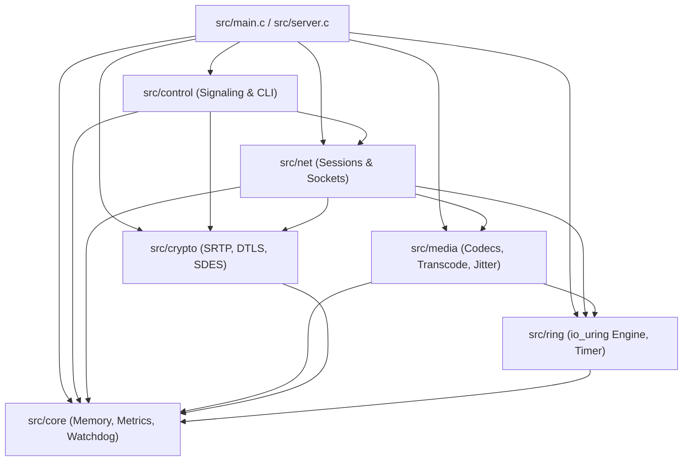
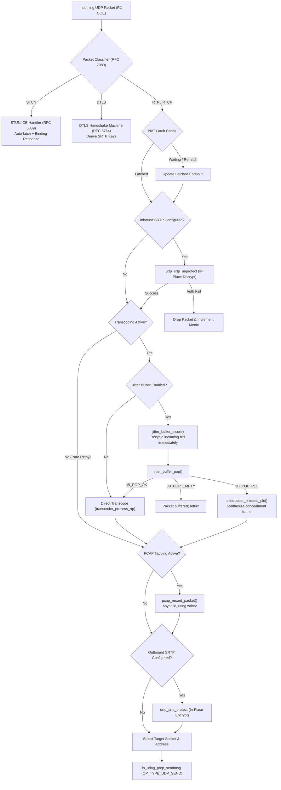
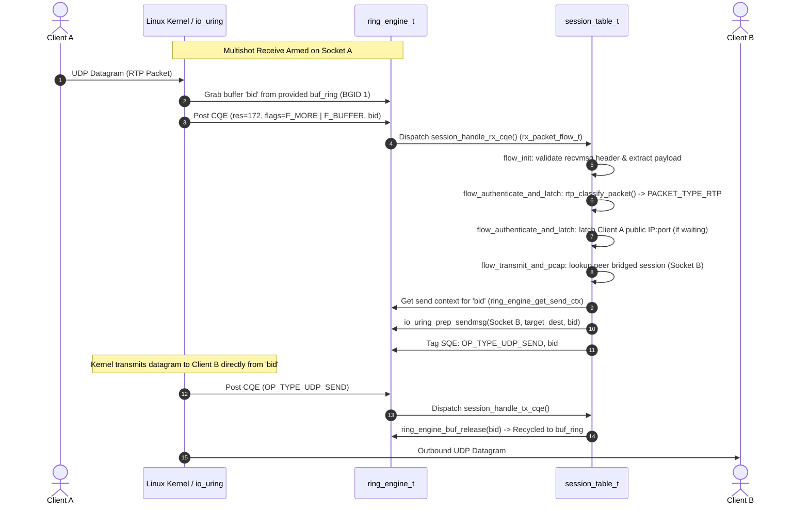
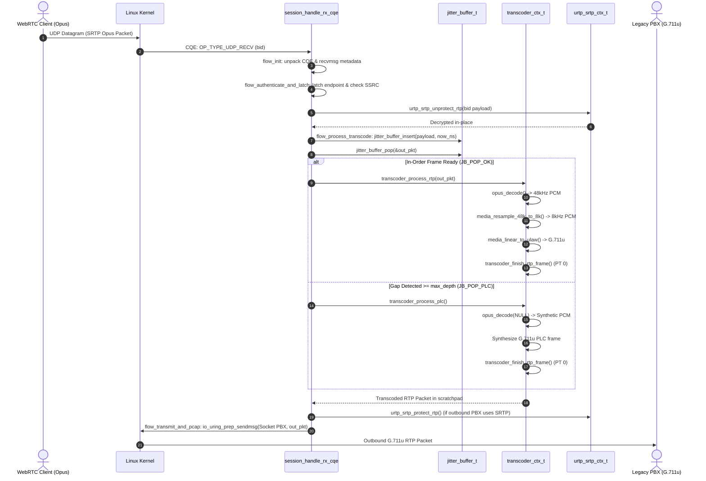

# urtp (uring-rtp) Architecture & Internals Specification

> **Target Audience:** GNU C23 Systems Engineers, Maintainers, and AI Coding Assistants.  
> **Document Purpose:** Canonical reference for the internal architecture, memory layout, execution lifecycles, and performance invariants of `urtp`.

---

## Table of Contents

1. [Executive Summary & Architectural Tenets](#1-executive-summary--architectural-tenets)
2. [Functional Domain Architecture & Directory Layout](#2-functional-domain-architecture--directory-layout)
3. [Memory Architecture & Allocation Lifecycle](#3-memory-architecture--allocation-lifecycle)
4. [The io_uring Reactor Engine](#4-the-io_uring-reactor-engine)
5. [Timer Architecture & Background Maintenance Tasks](#5-timer-architecture--background-maintenance-tasks)
6. [Media Pipeline, Transcoding & Jitter Buffer](#6-media-pipeline-transcoding--jitter-buffer)
7. [Network Layer, NAT Traversal & Demultiplexing](#7-network-layer-nat-traversal--demultiplexing)
8. [Cryptography, SRTP & WebRTC Gateway](#8-cryptography-srtp--webrtc-gateway)
9. [Control Plane & Signaling Protocols](#9-control-plane--signaling-protocols)
10. [End-to-End Execution Traces](#10-end-to-end-execution-traces)
11. [Architectural Invariants & AI Implementation Guide](#11-architectural-invariants--ai-implementation-guide)

---

## 1. Executive Summary & Architectural Tenets

[`urtp`](src/main.c) (uring-rtp) is an ultra-low-latency, carrier-grade RTP/RTCP media proxy written in modern **GNU C23** (`-std=gnu23`) targeting Linux 6.0+ kernels. Designed to act as a high-performance drop-in media relay for SIP proxies (e.g., Kamailio, OpenSIPS) and WebRTC gateways, `urtp` eliminates the kernel-userspace context switching and buffer-copying bottlenecks inherent to legacy `epoll`-based RTP engines.

```text
+─────────────────────────────────────────────────────────────────────────────+
|                                 urtp Reactor                                |
|                                                                             |
|   +──────────────────+      +───────────────────+      +────────────────+   |
|   |  Control Plane   |      |   Media Engine    |      | Timer Engine   |   |
|   | (UNIX / TCP / NG)|      | (RTP/RTCP/STUN/   |      |  (timerfd O(1) |   |
|   |                  |      |   DTLS/Transcode) |      |   Background)  |   |
|   +─────────┬────────+      +─────────┬─────────+      +────────┬───────+   |
|             │                         │                         │           |
|             ▼                         ▼                         ▼           |
|   +─────────────────────────────────────────────────────────────────────+   |
|   |         io_uring Multi-Ring Reactor Core (src/ring/ring.c)          |   |
|   |   - Multishot Receives (io_uring_prep_recvmsg_multishot)            |   |
|   |   - Provided Buffer Rings (io_uring_buf_ring / BGID 1)              |   |
|   |   - Buffer Reference Counting (Zero-Copy PCAP + Relay)              |   |
|   |   - SQPOLL Kernel Submission Thread (Zero-Syscall Hot Path)         |   |
|   +──────────────────────────────────┬──────────────────────────────────+   |
|                                      │                                      |
+──────────────────────────────────────┼──────────────────────────────────────+
                                       │
                      Linux 6.0+ Kernel / Hardware NIC
```

### Core Architectural Tenets

1. **Zero Dynamic Allocation in Hot Paths:**
   `malloc()`, `calloc()`, `realloc()`, and `free()` are strictly restricted to the startup and configuration phase. During active media relay, all packet buffers, session states, transcoder contexts, and jitter buffers are drawn from statically initialized arrays or CPU-cacheline-aligned memory pools (such as [`jitter_pool_t`](src/media/jitter.h) and aligned system allocators in [`src/core/memory.c`](src/core/memory.c)).
2. **Zero-Syscall Media Forwarding:**
   Through Linux 6.0+ `io_uring` kernel polling (`IORING_SETUP_SQPOLL`), multishot UDP receives (`io_uring_prep_recvmsg_multishot`), and provided buffer rings (`io_uring_buf_ring`), the main media processing loop performs zero syscalls during continuous stream forwarding. Media packets are received and transmitted purely through shared Submission Queue (SQ) and Completion Queue (CQ) memory rings.
3. **Zero-Copy & CoW Buffer Ownership:**
   Incoming network buffers allocated by the kernel from the provided buffer ring are passed directly to egress transmission queues without intermediate memory copies. When auxiliary services (e.g., PCAP recording) tap the stream, buffer ownership is managed via atomic reference counting (`ring_engine_buf_retain` / `ring_engine_buf_release`) rather than payload duplication.
4. **Strict GNU C23 Idiomatic Standard:**
   The codebase enforces `nullptr` exclusively (never `NULL` or `(void*)0`), `constexpr` for compile-time constants (never `#define` for magic values), `auto` for complex pointer inference, aggressive pointer qualification (`restrict`, "East Const" `T const * restrict const`), empty braced zero-initialization (`{}`), standard alignment attributes (`alignas(64)`), and `unreachable()` optimization hints.
5. **Data-Oriented Cacheline Alignment:**
   All hot-path structs are cacheline-padded and aligned to 64-byte boundaries (`alignas(64)` on the first member) to prevent false sharing across threads and eliminate unaligned memory access penalties in vectorized routines.

---

## 2. Functional Domain Architecture & Directory Layout

The codebase is partitioned into unidirectional, loosely coupled functional domains. Circular dependencies between domains are strictly forbidden:



### Domain Subsystem Directory

| Directory | Responsibility | Primary Header | Key Source |
| :--- | :--- | :--- | :--- |
| [`src/core/`](src/core/) | Aligned memory tracking, atomic metrics, supervisor watchdog, fast hashing, string views, utility macros. | [`memory.h`](src/core/memory.h), [`metrics.h`](src/core/metrics.h), [`watchdog.h`](src/core/watchdog.h) | [`memory.c`](src/core/memory.c), [`metrics.c`](src/core/metrics.c), [`watchdog.c`](src/core/watchdog.c) |
| [`src/ring/`](src/ring/) | `io_uring` instance abstraction, provided buffer ring setup, SQE submission, CQE harvesting, `timerfd` integration. | [`ring.h`](src/ring/ring.h), [`timer.h`](src/ring/timer.h) | [`ring.c`](src/ring/ring.c), [`timer.c`](src/ring/timer.c) |
| [`src/net/`](src/net/) | UDP socket management, session table, bidirectional stream bridging, NAT latching, STUN/ICE responder, PCAP call recorder. | [`session.h`](src/net/session.h), [`rtp.h`](src/net/rtp.h), [`stun.h`](src/net/stun.h), [`pcap.h`](src/net/pcap.h), [`udp.h`](src/net/udp.h) | [`session.c`](src/net/session.c), [`stun.c`](src/net/stun.c), [`pcap.c`](src/net/pcap.c), [`udp.c`](src/net/udp.c) |
| [`src/media/`](src/media/) | Audio transcoding (libopus, FFmpeg), sample rate conversion (8 kHz $\leftrightarrow$ 48 kHz), circular packet-driven jitter buffer, typed jitter pool, loss concealment (PLC). | [`transcode.h`](src/media/transcode.h), [`jitter.h`](src/media/jitter.h), [`codec.h`](src/media/codec.h) | [`transcode.c`](src/media/transcode.c), [`jitter.c`](src/media/jitter.c) |
| [`src/crypto/`](src/crypto/) | libsrtp2 context management, RFC 4568 SDES key parsing, DTLS 1.2 handshake machine, RFC 5764 DTLS-SRTP key material exporter. | [`srtp_session.h`](src/crypto/srtp_session.h), [`dtls.h`](src/crypto/dtls.h), [`sdes.h`](src/crypto/sdes.h), [`base64.h`](src/crypto/base64.h) | [`srtp_session.c`](src/crypto/srtp_session.c), [`dtls.c`](src/crypto/dtls.c), [`sdes.c`](src/crypto/sdes.c), [`base64.c`](src/crypto/base64.c) |
| [`src/control/`](src/control/) | UNIX/TCP command-line protocol, Kamailio/OpenSIPS Bencode NG protocol, unified SDP parsing and rewriting. | [`control.h`](src/control/control.h), [`ng.h`](src/control/ng.h), [`bencode.h`](src/control/bencode.h), [`sdp.h`](src/control/sdp.h) | [`control.c`](src/control/control.c), [`ng_msg.c`](src/control/ng_msg.c), [`ng_call.c`](src/control/ng_call.c), [`ng_negotiate.c`](src/control/ng_negotiate.c), [`ng_cmd.c`](src/control/ng_cmd.c), [`bencode.c`](src/control/bencode.c), [`sdp.c`](src/control/sdp.c) |

---

## 3. Memory Architecture & Allocation Lifecycle

`urtp` enforces a two-phase memory lifecycle:

1. **Bootstrap Phase:** All static memory arenas, provided buffer rings, send contexts, and allocator pools are allocated and page-aligned during `server_run()` / subsystem initialization.
2. **Operational Phase:** Dynamic runtime allocation is strictly prohibited. All data structures are bounded and zero-copy.

```text
+─────────────────────────────────────────────────────────────────────────────+
|                         Physical Process Memory                             |
|                                                                             |
|  +───────────────────────────────────────────────────────────────────────+  |
|  | Provided Buffer Arena (buffers): buf_entries * buf_size bytes         |  |
|  | - 64-byte posix_memalign; Registered with io_uring_setup_buf_ring     |  |
|  +───────────────────────────────────────────────────────────────────────+  |
|  +───────────────────────────────────────────────────────────────────────+  |
|  | Outbound Send Contexts (send_contexts): buf_entries * sizeof(ctx)     |  |
|  | - 64-byte posix_memalign; 1:1 indexed with Buffer ID (bid)            |  |
|  +───────────────────────────────────────────────────────────────────────+  |
|  +───────────────────────────────────────────────────────────────────────+  |
|  | Buffer Refcounts (buf_refcounts): buf_entries * sizeof(uint8_t)       |  |
|  | - Multi-consumer tracking for zero-copy PCAP + forward                |  |
|  +───────────────────────────────────────────────────────────────────────+  |
|  +───────────────────────────────────────────────────────────────────────+  |
|  | Session Table: SESSION_TABLE_MAX (512) * sizeof(relay_session_t)      |  |
|  | - Static array embedded in server_t                                   |  |
|  +───────────────────────────────────────────────────────────────────────+  |
|  +───────────────────────────────────────────────────────────────────────+  |
|  | Jitter Buffer Pool (jitter_pool): Typed Cacheline Pool (jitter_pool_t)|  |
|  | - 64 slots of sizeof(jitter_buffer_t) (~26 KB each) in media/jitter.h |  |
|  +───────────────────────────────────────────────────────────────────────+  |
+─────────────────────────────────────────────────────────────────────────────+
```

### 3.1 Allocators & Memory Management

#### 1. The Typed Jitter Buffer Pool (`jitter_pool_t` in [`src/media/jitter.h`](src/media/jitter.h))

Dynamic session-attached components (specifically [`jitter_buffer_t`](src/media/jitter.h)) are managed through a dedicated, cacheline-aligned block pool ([`jitter_pool_t`](src/media/jitter.h)):

- **Bounded Pre-allocation:** Pre-allocates up to `JITTER_POOL_CAPACITY` (64) instances of `jitter_buffer_t` aligned to 64 bytes (`alignas(64)`), eliminating dynamic allocations during session transcode negotiation.
- **Index Stack Pool Management:** Employs an array-backed index stack (`uint8_t free_indices[JITTER_POOL_CAPACITY]` with `uint32_t top`), ensuring $O(1)$ pop and push with bounded capacity and cache locality:

  ```c
  jitter_buffer_t * restrict const jb = jitter_pool_pop(pool);
  jitter_pool_push(pool, jb);
  ```

- **Zero Runtime Allocation:** The pool backing structure is created once at server startup via [`jitter_pool_create()`](src/media/jitter.c#L275) and destroyed on shutdown via [`jitter_pool_destroy()`](src/media/jitter.c#L288).

#### 2. Aligned System Memory Tracking ([`src/core/memory.c`](src/core/memory.c))

For subsystem bootstrap arenas (such as `io_uring` provided buffer rings, send contexts, and pool backings) that require explicit page or cacheline boundaries:

- **64-Byte Cacheline Alignment:** Enforces 64-byte alignment across all allocations via `posix_memalign`:

  ```c
  void *mem_alloc_aligned(size_t const alignment, size_t const size);
  void  mem_free_aligned(void *const ptr, size_t const size);
  ```

- **Global Memory Accounting:** Tracks active heap allocation sizes via an atomic counter:

  ```c
  static _Atomic uint64_t _total_bytes_allocated = 0;
  ```

  Enables real-time memory footprint querying via [`memory_total_allocated()`](src/core/memory.c#L8) and the Prometheus telemetry exporter.

---

## 4. The io_uring Reactor Engine

The core event loop is encapsulated in [`ring_engine_t`](src/ring/ring.h) ([`src/ring/ring.c`](src/ring/ring.c)).

### 4.1 Tagged 64-Bit User Data (`user_data_tag_t`)

`io_uring` requests pass a 64-bit integer through `sqe->user_data` that is echoed back verbatim in the Completion Queue Entry (`cqe->user_data`). `urtp` structures this 64-bit word as an explicit bitfield union:

```c
typedef union {
    struct {
        uint16_t index;    // Target session slot index [0..512)
        uint16_t op_type;  // Operation type enum (op_type_t)
        uint16_t bid;      // Provided buffer ID from kernel buffer ring
        uint16_t flags;    // Packet classification tags (TAG_FLAG_PKT_RTP / RTCP)
    } fields;
    uint64_t raw;
} user_data_tag_t;

static_assert(sizeof(user_data_tag_t) == sizeof(uint64_t), "user_data_tag_t must be 64 bits");
```

#### Operation Types (`op_type_t`)

```c
typedef enum : uint16_t {
    OP_TYPE_NONE             = 0,
    OP_TYPE_UDP_RECV         = 1, // Ingress media datagram
    OP_TYPE_UDP_SEND         = 2, // Outbound media forward completion
    OP_TYPE_CONTROL_ACCEPT   = 3, // Inbound control TCP client connection
    OP_TYPE_CONTROL_RECV     = 4, // Control command read (UNIX / TCP)
    OP_TYPE_CONTROL_SEND     = 5, // Control response transmission
    OP_TYPE_CONTROL_UDP_RECV = 6, // Inbound Kamailio/OpenSIPS NG command datagram
    OP_TYPE_CONTROL_UDP_SEND = 7, // Outbound NG response datagram completion
    OP_TYPE_PCAP_WRITE       = 8, // Asynchronous disk write completion for PCAP
    OP_TYPE_TIMER_TICK       = 9, // Periodic 1-second maintenance tick
} op_type_t;
```

### 4.2 Provided Buffer Rings (`io_uring_buf_ring`)

To avoid submitting individual `recvmsg` SQEs for every incoming datagram:

1. **Buffer Ring Setup:** [`ring_engine_init()`](src/ring/ring.c#L6) configures an `io_uring_buf_ring` with `buf_entries` (default 1024) in Buffer Group ID 1 (`bgid = 1`).
2. **Buffer Registration:** `buffers` is allocated as a contiguous memory block of `buf_entries * buf_size` bytes. Each buffer index `i` is added to the ring via `io_uring_buf_ring_add()` with address `&buffers[i * buf_size]` and buffer ID `bid = i`. The ring is committed once with `io_uring_buf_ring_advance()`.
3. **Multishot Reception:** Sockets are armed with `io_uring_prep_recvmsg_multishot()` ([`session_arm_multishot`](src/net/session.c#L347)). The kernel continuously consumes buffer IDs from the buffer ring and produces completion entries without requiring socket re-arming.
4. **Buffer Extraction:** On an incoming CQE, the kernel sets `IORING_CQE_F_BUFFER` and provides the buffer ID in `cqe->flags >> IORING_CQE_BUFFER_SHIFT`. The application retrieves the pointer via [`ring_engine_get_buf()`](src/ring/ring.h#L126).
5. **Multi-Consumer Reference Counting:**
   - [`ring_engine_buf_retain()`](src/ring/ring.c#L140): Increments `buf_refcounts[bid]`.
   - [`ring_engine_buf_release()`](src/ring/ring.c#L151): Decrements reference count. If count drops to 0, it invokes [`ring_engine_recycle_buf()`](src/ring/ring.c#L124), executing `io_uring_buf_ring_add()` and `io_uring_buf_ring_advance(..., 1)` to immediately return the buffer to the kernel.

### 4.3 Kernel Polling Mode (`IORING_SETUP_SQPOLL`)

When `--sqpoll` is supplied:

- `urtp` requests an asynchronous kernel submission thread (`params.flags |= IORING_SETUP_SQPOLL`, `sq_thread_idle = 2000`).
- If privileged capabilities (`CAP_SYS_ADMIN` or `CAP_SYS_NICE`) permit, the kernel thread polls the submission queue. The user space process submits requests by writing directly to memory without making `enter()` or `io_uring_submit()` syscalls.
- If unprivileged, `ring_engine_init()` automatically falls back to standard event-driven submission.

### 4.4 The Reactor Loop ([`server_run`](src/server.c#L272))

```c
constexpr unsigned int BATCH_CQE_COUNT = 64;
struct io_uring_cqe *cqes[BATCH_CQE_COUNT] = {};

while (!g_force_shutdown) {
    // 1. Submit pending SQEs and wait for at least 1 completion
    int const wait_ret = ring_engine_submit_and_wait(&(server.ring_engine), 1);
    if (unlikely(wait_ret < 0 && wait_ret != -EINTR)) break;

    // 2. Harvest completions in batches of up to 64
    auto const count = io_uring_peek_batch_cqe(&(server.ring_engine.ring), cqes, BATCH_CQE_COUNT);

    // 3. Dispatch each CQE via tag.fields.op_type
    for (unsigned int i = 0; i < count; ++i) {
        user_data_tag_t const tag = {.raw = cqes[i]->user_data};
        switch (tag.fields.op_type) {
            case OP_TYPE_UDP_RECV:       session_handle_rx_cqe(...); break;
            case OP_TYPE_UDP_SEND:       session_handle_tx_cqe(...); break;
            case OP_TYPE_CONTROL_RECV:   control_server_handle_rx_cqe(...); break;
            case OP_TYPE_TIMER_TICK:     /* Maintenance tasks */ break;
            // ...
        }
    }

    // 4. Advance completion ring
    if (count > 0) {
        io_uring_cq_advance(&(server.ring_engine.ring), count);
    }
}
```

---

## 5. Timer Architecture & Background Maintenance Tasks

Background tasks (inactivity sweeping, watchdog heartbeats, telemetry rollups) must never add jitter to real-time RTP packets or introduce thread synchronization locks.

```text
+─────────────────────────────────────────────────────────────────────────────+
|                         Timer & Background Pipeline                         |
|                                                                             |
|   1. timerfd_create(CLOCK_MONOTONIC, TFD_NONBLOCK)                          |
|   2. Arm via io_uring_prep_read(timer_fd, &tick_buf, sizeof(uint64_t), 0)   |
|      Tagged with: OP_TYPE_TIMER_TICK                                        |
|                                                                             |
|                                    │ (Kernel 1-second timeout fires)        |
|                                    ▼                                        |
|                          CQE: OP_TYPE_TIMER_TICK                            |
|                                    │                                        |
|         ┌──────────────────────────┼──────────────────────────┐             |
|         ▼                          ▼                          ▼             |
|  1. Watchdog Ping          2. Inactivity Sweep        3. Metrics Rollup     |
|     (watchdog_ping)           (O(N) Session Scan)        (Delta Rates)      |
|     - Send WATCHDOG=1         - Check setup timeout      - Ingress/egress   |
|       to NOTIFY_SOCKET          (default 30s)              PPS and Kbps     |
|     - Detect reactor          - Check media silence      - SSRC idle        |
|       stalls (>100ms)           (default 60s)              gauges           |
|                               - Reap ghost sessions                         |
|                               - Unbridge peers                              |
|                               - Remove NG calls                             |
|                                    │                                        |
|                                    ▼                                        |
|   4. Re-arm io_uring_prep_read on timer_fd for next 1-second tick           |
+─────────────────────────────────────────────────────────────────────────────+
```

### 5.1 Monotonic `timerfd` on the Ring ([`src/ring/timer.c`](src/ring/timer.c))

- [`timer_engine_init()`](src/ring/timer.c#L5) creates a monotonic timer descriptor:

  ```c
  int const fd = timerfd_create(CLOCK_MONOTONIC, TFD_NONBLOCK | TFD_CLOEXEC);
  ```

- Armed with a 1-second periodic interval: `it_interval = 1s`, `it_value = 1s`.
- [`timer_engine_arm()`](src/ring/timer.c#L49) prepares an `io_uring_prep_read()` on `timer_fd` for 8 bytes (`sizeof(uint64_t)`) tagged with `OP_TYPE_TIMER_TICK`.
- When the timer expires, the kernel writes the 8-byte tick count and posts a CQE. The reactor dispatches background jobs in fixed sequential order and re-arms the read request via [`timer_engine_rearm()`](src/ring/timer.c#L79).

### 5.2 The 1-Second Maintenance Pipeline

Dispatched on every `OP_TYPE_TIMER_TICK` CQE:

1. **Clock Cache Synchronization:** Reads `CLOCK_MONOTONIC` once per tick and writes `server.session_table.cached_monotonic_sec`. All packet handlers read this cached integer, avoiding `clock_gettime()` syscalls in the packet hot path.
2. **Watchdog Heartbeat ([`watchdog_ping`](src/core/watchdog.c#L80)):**
   Inspects `NOTIFY_SOCKET` and `WATCHDOG_USEC`. If running under `systemd`, emits a non-blocking `WATCHDOG=1` datagram over a UNIX domain socket.
3. **Inactivity & Ghost Call Sweeper ([`session_table_sweep_inactivity`](src/net/session.c#L1230)):**
   Performs an O(N) sweep of the 512 session slots:
   - **Setup Timeout (`setup_timeout_sec`, default 30s):** If `packets_relayed == 0` and `(now_sec - created_sec) >= setup_timeout_sec`, tears down the unconfirmed session.
   - **Media Silence Timeout (`inactivity_timeout_sec`, default 60s):** If `packets_relayed > 0` and `(now_sec - last_activity_sec) >= timeout`, terminates the abandoned session.
   - **Teardown Sequence:** Recursively unbridges peer session, removes NG call entries from [`ng_call_table_t`](src/control/ng.h), closes UDP sockets, releases PCAP recorders, and recycles jitter buffers.
4. **Metrics Rollup ([`metrics_rollup`](src/core/metrics.c#L17)):**
   Computes deltas against `last_snapshot`:

   ```math
   \Delta \text{rx\_packets} = \text{cumulative.rx\_packets} - \text{last\_snapshot.rx\_packets}
   ```

   ```math
   \text{rate\_per\_sec.tx\_bytes} = \text{cumulative.tx\_bytes} - \text{last\_snapshot.tx\_bytes}
   ```

   Calculates instantaneous ingress/egress PPS and bitrates without floating-point division.
5. **Reactor Stall Detection:** Measures time elapsed processing a CQE batch (`iter_duration_ms`). If it exceeds `DEFAULT_STALL_THRESHOLD_MS` (100 ms), a warning is emitted to flag slow synchronous operations.

---

## 6. Media Pipeline, Transcoding & Jitter Buffer

The media forwarding path handles raw RTP/RTCP packets, symmetric NAT latching, transcoding, jitter buffering, and PCAP tapping.



### 6.1 Transcoding Architecture ([`src/media/transcode.c`](src/media/transcode.c))

`urtp` bridges narrowband telephony codecs (G.711 PCMU / PCMA at 8 kHz) with wideband WebRTC codecs (Opus at 48 kHz).

#### Dual Backend Architecture

1. **`TRANSCODER_BACKEND_OPUS` (Native):**
   - High-throughput path using `libopus` (`opus_decoder_create`, `opus_encoder_create`).
   - Integrated high-speed linear resamplers:
     - [`media_resample_48k_to_8k`](src/media/codec.h#L248): Downsamples 960 samples (20 ms at 48 kHz) to 160 samples (20 ms at 8 kHz) using a 6:1 decimation filter.
     - [`media_resample_8k_to_48k`](src/media/codec.h#L273): Upsamples 160 samples to 960 samples using linear interpolation.
     - Fast bitwise $\mu$-law / A-law lookup tables (`media_linear_to_ulaw`, `media_ulaw_to_linear`).
2. **`TRANSCODER_BACKEND_FFMPEG`:**
   - Universal transcoding using `libavcodec` (`AVCodecContext`) and `libswresample` (`SwrContext`).
   - Pre-allocates `AVFrame` and `AVPacket` instances in [`transcoder_init()`](src/media/transcode.c#L40) to prevent runtime allocations.

#### Zero-Allocation Context Scratchpads

[`transcoder_ctx_t`](src/media/transcode.h#L18) embeds static arrays:

```c
int16_t pcm_48k[MEDIA_SAMPLES_48K_20MS]; // 960 * 2 = 1920 bytes
int16_t pcm_8k[MEDIA_SAMPLES_8K_20MS];   // 160 * 2 = 320 bytes
uint8_t scratch_buf[2048];               // Direct I/O staging buffer
```

No dynamic allocation occurs when encoding or decoding audio frames.

#### RFC 3550 RTP Header Reconstruction & Frame Assembly

When transcoding audio frames:

1. The incoming packet's RTP header is validated and stripped.
2. The payload is decoded to linear PCM, resampled, and re-encoded.
3. Both regular transcoded audio frames and synthetic Packet Loss Concealment (PLC) frames are assembled into outbound RFC 3550 RTP packets via the unified [`transcoder_finish_rtp_frame()`](src/media/transcode.c#L236) helper:
   - Target payload type assigned (`ctx->dst_pt`) with marker bit preservation.
   - Monotonic sequence incremented (`out_hdr->seq = htons(ctx->outbound_seq++)`).
   - Monotonic timestamp scaled by destination sampling rate via [`media_codec_frame_samples_20ms()`](src/media/codec.h) (`ctx->outbound_ts += 160` for 8 kHz, or `+= 960` for 48 kHz).
   - Ingress SSRC preserved or reassigned.
   - Output byte length updated and stats tracked (`packets_out`, `bytes_out`).

---

### 6.2 High-Performance Jitter Buffer ([`src/media/jitter.c`](src/media/jitter.c))

#### The Invariant Architectural Constraint
>
> **The jitter buffer is strictly coupled to the transcoding engine:**
>
> - In **pure media forwarding**, the jitter buffer **never executes**. Media packets follow the zero-copy `io_uring` path.
> - When transcoding is enabled, out-of-order packets corrupt stateful LPC decoders (Opus SILK/CELT). The jitter buffer reorders frames and handles Packet Loss Concealment (PLC).
> - Enabling jitter buffering without transcoding is rejected by CLI and control protocols.

#### Memory Layout & Slot Sizing

```c
constexpr size_t   JITTER_BUFFER_MAX_SLOTS = 16;   // Power of two for bitmask modulo
constexpr size_t   JITTER_SLOT_MAX_SIZE    = 1600; // MTU capacity
constexpr uint32_t JITTER_DEFAULT_DELAY_MS = 40;   // 2 frames at 20ms
```

- Embedded slot array: `jitter_slot_t slots[16]`.
- Fast modulo indexing via bitwise AND:

  ```math
  \text{slot\_idx} = \text{seq} \ \& \ (\text{JITTER\_BUFFER\_MAX\_SLOTS} - 1)
  ```

- RFC 3550 16-bit sequence arithmetic with wrap-around:

  ```c
  static inline int16_t jitter_seq_diff(uint16_t const s1, uint16_t const s2) {
      return (int16_t)(s1 - s2);
  }
  ```

#### Ingestion Algorithm ([`jitter_buffer_insert`](src/media/jitter.c#L81))

1. Validates RTP version and payload size.
2. Extracts `seq` and `timestamp`.
3. **Playout Distance Check (`diff = seq - next_playout_seq`):**
   - `diff < 0`: Packet arrived too late (already played out). Increments `packets_dropped_late`, returns `false`.
   - `diff >= 16`: Sequence jump or remote reboot. Calls [`jitter_buffer_flush()`](src/media/jitter.c#L61) and re-anchors playout.
4. **Duplicate & Collision Check:** If `slot->occupied && slot->seq == seq`, increments `packets_dropped_dup` and drops. If slot contains an un-popped older packet, increments `packets_dropped_overflow`.
5. Copies packet to slot, sets `occupied = true`, increments `occupancy`.
6. Tracks out-of-order arrival: if `seq - highest_rx_seq < 0`, increments `packets_reordered`. Otherwise updates `highest_rx_seq = seq`.
7. **Immediate Provided Buffer Recycling:** In [`session_handle_rx_cqe`](src/net/session.c#L741), the kernel buffer ID (`bid`) is recycled back to the ring *immediately* after copying to the slot. This prevents ring buffer starvation while packets sit in the jitter buffer.

#### Reactive (Packet-Driven) Playout Model ([`jitter_buffer_pop`](src/media/jitter.c#L187))

Zero timer syscalls are used. Playout is driven reactively by incoming packets:

1. **Pre-buffering State:** If `buffering == true`, returns `JB_POP_EMPTY` until `occupancy >= target_depth` (e.g. 2 packets / 40 ms).
2. **In-Order Packet Available (`JB_POP_OK`):**
   When `slots[next_playout_seq & 15]` is occupied with matching sequence:
   - Copies packet to caller output buffer.
   - Clears slot, decrements `occupancy`, advances `next_playout_seq++`.
   - Returns `JB_POP_OK`.
3. **Packet Loss Gap Detection (`JB_POP_PLC`):**
   When the target slot is empty:
   - Computes drift lag: `lag = highest_rx_seq - next_playout_seq`.
   - If `lag >= max_depth` (e.g. 4 packets / 80 ms), the packet is declared lost.
   - Sets `plc_until_seq = highest_rx_seq`, increments `loss_concealments`, advances `next_playout_seq++`.
   - Returns `JB_POP_PLC`.
   - The transcoder catches `JB_POP_PLC` and calls [`transcoder_process_plc()`](src/media/transcode.c#L590), executing native `opus_decode(..., nullptr, 0, ...)` to generate synthetic concealment audio without resetting the decoder state.
4. **Allowable Jitter Lag:** If slot is empty but `lag < max_depth`, the system waits for the straggling packet, returning `JB_POP_EMPTY`.

---

## 7. Network Layer, NAT Traversal & Demultiplexing

### 7.1 RFC 7983 Packet Demultiplexing ([`src/net/rtp.h`](src/net/rtp.h#L177))

Incoming UDP datagrams on media ports are demultiplexed in-place based on the first byte:

```c
packet_type_t const pkt_type = rtp_classify_packet(payload, payload_len);
```

| First Byte Range | Protocol | Identification Logic | Action |
| :--- | :--- | :--- | :--- |
| `00xxxxxx` (0..3) | **STUN / ICE** | Length $\ge 20$ and `magic_cookie == 0x2112A442` | [`stun_is_binding_request`](src/net/stun.c#L17) $\rightarrow$ send STUN response |
| `00010100..00111111` (20..63) | **DTLS** | Length $\ge 13$ | [`urtp_dtls_feed_packet`](src/crypto/dtls.c#L182) $\rightarrow$ step DTLS machine |
| `10xxxxxx` (128..191) | **RTCP** | Version = 2 and Payload Type $\in [200, 223]$ | RTCP stats tracking / forward to RTCP port |
| `10xxxxxx` (128..191) | **RTP** | Version = 2 and Payload Type $\notin [200, 223]$ | Media forwarding / transcode pipeline |

### 7.2 Symmetric RTP & NAT Latching ([`src/net/session.c`](src/net/session.c#L170))

SIP clients behind symmetric NATs routinely report private RFC 1918 addresses in their SDP `c=` lines.

- **State Machine:**
  - `LATCH_MODE_DISABLED`: Static destination IP:port configured. Packets sent directly.
  - `LATCH_MODE_WAITING`: Session port allocated, but remote public address unknown. Media transmission is paused.
  - `LATCH_MODE_LATCHED`: First valid packet received. Public source IP and port extracted from `io_uring_recvmsg_name()` and copied into `latched_addr`. All egress media forwarded to this latched endpoint.
- **Dynamic Re-Latching (`allow_relatch`):** If a mobile client changes networks mid-call (e.g. Wi-Fi $\rightarrow$ LTE), the engine updates the latched endpoint upon receiving packets from the new source address.

### 7.3 Asynchronous PCAP Recording ([`src/net/pcap.c`](src/net/pcap.c))

Calls can be tapped to disk without blocking the media loop:

- Up to 64 concurrent file recorders ([`pcap_table_t`](src/net/pcap.h#L143)).
- Uses standard Libpcap 2.4 format with microsecond resolution (`PCAP_MAGIC_USEC = 0xa1b2c3d4`).
- **Asynchronous Disk I/O:** Header and payload are assembled into an `iovec[2]` and submitted to `io_uring` via `io_uring_prep_writev()`.
- **Zero-Copy Disk Writes:** If outbound SRTP is not enabled, the disk write takes a reference on the provided buffer ID via [`ring_engine_buf_retain()`](src/ring/ring.c#L140). The buffer is shared between network TX and disk write without copying payload bytes. When the write CQE completes (`OP_TYPE_PCAP_WRITE`), [`pcap_handle_write_cqe()`](src/net/pcap.c#L244) releases the buffer.
- **Pre-Encryption Copy:** If outbound SRTP will encrypt the buffer in-place, the plaintext payload is copied into a pre-allocated recorder staging buffer (`copy_bufs`) before encryption runs.

### 7.4 Ingress Forwarding Engine & Shared Stack Frame ([`src/net/session.c`](src/net/session.c))

Ingress packet processing in [`session_handle_rx_cqe()`](src/net/session.c#L1086) is decomposed from a monolithic dispatcher into a linear execution pipeline operating over a single shared stack frame (`rx_packet_flow_t`):

```text
+─────────────────────────────────────────────────────────────────────────────+
|                         rx_packet_flow_t Pipeline                           |
|                                                                             |
|  1. flow_init                                                               |
|     - Validates CQE, unpacks io_uring_recvmsg_out header, offsets payload   |
|     - Updates ingress packet/byte telemetry                                 |
|                                                                             |
|  2. flow_handle_control_protocols                                           |
|     - RFC 7983 classification: STUN binding requests & DTLS handshake       |
|     - Immediate buffer recycle or async response submission                 |
|                                                                             |
|  3. flow_authenticate_and_latch                                             |
|     - Symmetric NAT latching & video RTCP PLI keyframe request              |
|     - SSRC/PT routing demux & inbound SRTP decryption                       |
|                                                                             |
|  4. flow_process_transcode                                                  |
|     - Ingests into jitter_buffer_t (if transcode active)                    |
|     - Reactive jitter playout (JB_POP_OK / JB_POP_PLC) & audio transcode    |
|                                                                             |
|  5. flow_transmit_and_pcap                                                  |
|     - Zero-copy PCAP call recording tap (ring_engine_buf_retain)            |
|     - Outbound SRTP in-place encryption                                     |
|     - Asynchronous io_uring_prep_sendmsg SQE submission                     |
+─────────────────────────────────────────────────────────────────────────────+
```

#### Centralized Buffer Recycling Invariant

To guarantee zero buffer leakage and eliminate duplicate release bugs across complex branching paths, `session_handle_rx_cqe` routes all failure conditions, packet drops, and non-forwarding exits through a single centralized label:

```c
recycle:
    ring_engine_recycle_buf(engine, flow.bid);
```

- When packet processing succeeds and `flow_transmit_and_pcap` submits an asynchronous send SQE, the provided buffer is retained for transmission and released upon TX completion in [`session_handle_tx_cqe()`](src/net/session.c#L1134).
- When a packet is dropped at any stage (validation failure, auth error, jitter buffering wait, or SQE exhaustion), execution jumps directly to `recycle:`, instantly returning the buffer ID to the `io_uring` provided buffer ring.

---

## 8. Cryptography, SRTP & WebRTC Gateway

### 8.1 SRTP Engine ([`src/crypto/srtp_session.c`](src/crypto/srtp_session.c))

Built on `libsrtp2`. Supports standard RFC 4568 SDES and RFC 5764 DTLS-SRTP crypto suites:

- `SRTP_CRYPTO_SUITE_AES_CM_128_HMAC_SHA1_80` (Standard VoIP)
- `SRTP_CRYPTO_SUITE_AES_CM_128_HMAC_SHA1_32` (Bandwidth-constrained RTCP)
- `SRTP_CRYPTO_SUITE_AEAD_AES_128_GCM` (Modern WebRTC)
- `SRTP_CRYPTO_SUITE_AEAD_AES_256_GCM` (High-security WebRTC)

#### In-Place Protection

Incoming protected packets are decrypted in-place in their provided buffer via [`urtp_srtp_unprotect_rtp()`](src/crypto/srtp_session.c#L106). Outbound packets are encrypted in-place via [`urtp_srtp_protect_rtp()`](src/crypto/srtp_session.c#L88), ensuring authentication tags fit within the buffer padding.

### 8.2 DTLS 1.2 State Machine ([`src/crypto/dtls.c`](src/crypto/dtls.c))

Enables WebRTC browser endpoints (Chrome, Firefox, Safari) to establish secure media channels:

- Global OpenSSL context generates an ECDSA P-256 certificate and computes its SHA-256 fingerprint ([`urtp_dtls_global_init`](src/crypto/dtls.c#L26)).
- Each session encapsulates non-blocking OpenSSL memory BIOs (`in_bio`, `out_bio`).
- When DTLS datagrams arrive, they are fed into `in_bio`, and [`urtp_dtls_step()`](src/crypto/dtls.c#L201) drives the handshake state machine.
- Pending handshake packets from `out_bio` are sent back over the UDP socket via `io_uring_prep_sendmsg`.
- **RFC 5764 Key Extraction:** Once `DTLS_STATE_CONNECTED` is reached, [`urtp_dtls_export_srtp_keys()`](src/crypto/dtls.c#L226) uses `SSL_export_keying_material()` with label `"EXTRACTOR-dtls_srtp"` to derive master keys and salt, immediately instantiating inbound and outbound `urtp_srtp_ctx_t` engines.

---

## 9. Control Plane & Signaling Protocols

`urtp` exposes a dual-protocol control plane.

```text
+─────────────────────────────────────────────────────────────────────────────+
|                                Control Plane                                |
|                                                                             |
|   1. Text Protocol (UNIX Domain Socket / TCP Port)                          |
|      - Cacheline-aligned command dispatch table (COMMANDS[])                |
|      - Commands: ALLOCATE, BRIDGE, DELETE, TRANSCODE, LATCH, STATUS, etc.   |
|      - Embedded HTTP GET /metrics Prometheus scraper                        |
|                                                                             |
|   2. NG Protocol (UDP Port 22222 - Kamailio / OpenSIPS Drop-In)             |
|      - Bencoded request/response envelopes with cookie echo                 |
|      - Commands: ping, offer, answer, delete, query, list                   |
|      - Consolidated offer/answer negotiation (ng_negotiate.c)               |
|      - Unified SDP Parsing & Rewriting (sdp_parse / sdp_rewrite_opts)       |
|      - SDES & DTLS crypto parameter negotiation                             |
+─────────────────────────────────────────────────────────────────────────────+
```

### 9.1 Static Command Table Dispatch ([`src/control/control.c`](src/control/control.c#L844))

Text commands are matched using a contiguous, cacheline-aligned static lookup table (`COMMANDS[]`):

```c
static cmd_entry_t const COMMANDS[] = {
    {.verb = SV_STATIC("PING"),      .handler = handle_ping},
    {.verb = SV_STATIC("GET"),       .handler = handle_http_get},
    {.verb = SV_STATIC("STATUS"),    .handler = handle_status},
    {.verb = SV_STATIC("BRIDGE"),    .handler = handle_bridge},
    {.verb = SV_STATIC("ALLOCATE"),  .handler = handle_allocate},
    {.verb = SV_STATIC("DELETE"),    .handler = handle_delete},
    {.verb = SV_STATIC("LATCH"),     .handler = handle_latch},
    {.verb = SV_STATIC("TRANSCODE"), .handler = handle_transcode},
    {.verb = SV_STATIC("RECORD"),    .handler = handle_record},
    {.verb = SV_STATIC("QUIT"),      .handler = handle_quit},
};
```

- **Cache-Efficient Linear Scan:** For the bounded command set (~10 commands), a contiguous linear scan over string views (`sv_t`) eliminates dynamic hash tables, collisions, and extra heap allocations while fitting entirely within a single L1 CPU cacheline.
- **Prometheus Telemetry Integration:** Commands such as `STATUS METRICS` and HTTP `GET /metrics` format server counters via [`metrics_format_prometheus()`](src/core/metrics.c#L207) and active session SSRC gauges via [`metrics_format_ssrc()`](src/core/metrics.c#L420) and [`session_table_format_ssrc_metrics()`](src/net/session.c#L1591).

| Verb | Syntax | Action |
| :--- | :--- | :--- |
| `ALLOCATE` | `ALLOCATE [port] [dest_ip] [dest_port]` | Creates new relay session slot |
| `BRIDGE` | `BRIDGE <port_a> <port_b>` | Connects two sessions bidirectionally |
| `DELETE` | `DELETE <port>` | Closes socket and frees session slot |
| `TRANSCODE` | `TRANSCODE <port> backend=<libopus\|ffmpeg> dst=<codec> [jitter=<ms>]` | Configures audio transcoder and jitter buffer |
| `LATCH` | `LATCH <port> [enable\|disable\|relatch]` | Configures symmetric NAT latching mode |
| `RECORD` | `RECORD <port> [start\|stop] [dir=<path>]` | Taps session to PCAP file |
| `STATUS` | `STATUS [METRICS]` | Outputs human status or Prometheus metrics |
| `GET` | `GET /metrics HTTP/1.1` | Native Prometheus scraper endpoint over TCP |

### 9.2 The NG Protocol & Consolidated Negotiation ([`src/control/ng_msg.c`](src/control/ng_msg.c), [`src/control/ng_negotiate.c`](src/control/ng_negotiate.c))

Acts as a drop-in replacement for Sipwise `rtpengine`:

- Listens on UDP port 22222 (configurable).
- Encapsulates requests as `<cookie> <bencoded_dict>` (e.g. `1234_1 d7:command5:offere...`).
- Handles `ping`, `offer`, `answer`, `delete`, `query`, and `list`.
- **Consolidated Negotiation Engine ([`src/control/ng_negotiate.c`](src/control/ng_negotiate.c)):**
  Unified request parsing ([`ng_parse_call_req()`](src/control/ng_negotiate.c#L13)) and execution ([`ng_execute_negotiation()`](src/control/ng_negotiate.c#L67)) process both SIP `offer` and `answer` commands through a single `ng_call_req_t` abstraction, eliminating duplicated validation, port reservation, and SDP response formatting.
- **Unified SDP Parsing & Rewriting ([`src/control/sdp.c`](src/control/sdp.c)):**
  - High-performance zero-copy SDP parser ([`sdp_parse()`](src/control/sdp.c#L51)) validates session metadata, connection addresses, media descriptors, and crypto attributes directly from string views (`sv_t`).
  - Unified options-driven rewrite engine ([`sdp_rewrite_opts()`](src/control/sdp.c#L530)) rewrites `c=` IP to proxy IP, dynamically allocates even ports from `[30000..40000]`, configures `a=rtcp-mux`, and injects SDES `a=crypto:` or WebRTC `a=ice-ufrag` / `a=fingerprint`, returning the rewritten SDP in a bencoded response echoing the caller's cookie.

---

## 10. End-to-End Execution Traces

### Trace 1: Pure Media Relay (Zero-Copy Hot Path)



### Trace 2: Transcoding with Jitter Buffer and Outbound SRTP



---

## 11. Architectural Invariants & AI Implementation Guide

When modifying, extending, or maintaining `urtp`, all human developers and AI coding assistants **must adhere strictly to the following invariants**:

### 1. The Zero-Allocation Hot Path Invariant

- **Rule:** Never call `malloc()`, `calloc()`, `realloc()`, or `free()` inside `src/net/`, `src/ring/`, `src/media/`, or `src/crypto/` during packet processing.
- **Enforcement:** All structures must be allocated during boot or drawn from pre-allocated memory pools (such as [`jitter_pool_t`](src/media/jitter.h#L160)).
- **Verification:** Run `./scripts/build.sh sanitize test` and verify clean memory traces.

### 2. The Buffer Recycling Invariant

- **Rule:** Every buffer ID (`bid`) delivered via a multishot receive CQE (`IORING_CQE_F_BUFFER`) **must** be recycled back to the buffer ring exactly once.
- **Enforcement:**
  - In [`session_handle_rx_cqe()`](src/net/session.c#L1086), execution flows through the `rx_packet_flow_t` pipeline, with all non-forwarding exits, validation errors, and dropped packets routing directly to a canonical `recycle:` label where [`ring_engine_recycle_buf()`](src/ring/ring.c#L124) is invoked.
  - If forwarded, buffer recycling is deferred: the buffer is retained for transmission and released via [`ring_engine_buf_release()`](src/ring/ring.c#L151) upon TX CQE completion in [`session_handle_tx_cqe()`](src/net/session.c#L1134).
  - For bifurcated streams (forwarding + PCAP), call [`ring_engine_buf_retain()`](src/ring/ring.c#L140) before submitting the secondary SQE.

### 3. The Jitter Buffer Coupling Invariant

- **Rule:** The jitter buffer **must only** execute when transcoding is active on the session.
- **Enforcement:**
  - Pure RTP/RTCP forwarding must bypass the jitter buffer completely.
  - Never allow control plane commands or CLI flags to attach a jitter buffer to a non-transcoded relay session.

### 4. The Single-Threaded Reactor Invariant

- **Rule:** Never introduce `pthread_mutex_t`, spinlocks, or blocking system calls (`usleep()`, `sleep()`, synchronous file I/O) into the reactor thread.
- **Enforcement:** Inter-session communication and maintenance tasks must execute within the `io_uring` completion loop. Asynchronous disk operations (PCAP) must be submitted via `io_uring_prep_writev`.
